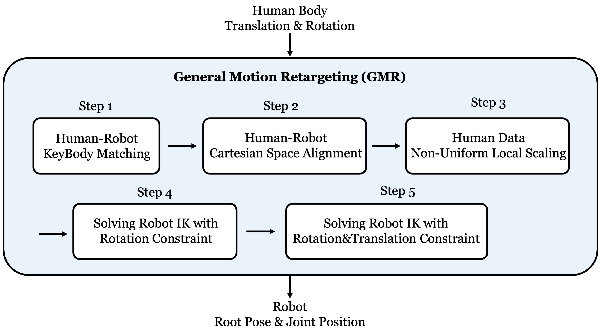

# GMR: General Motion Retargeting(Fork for IK-CONFIG auto-generation)

  <a href="https://arxiv.org/abs/2505.02833">
    
  </a> <a href="https://arxiv.org/abs/2510.02252">
    
  </a> <a href="https://opensource.org/licenses/MIT">
    
  </a> <a href="https://github.com/YanjieZe/GMR/releases">
    
  </a> <a href="https://x.com/ZeYanjie/status/1952446745696469334">
    
  </a> <a href="https://yanjieze.github.io/humanoid-foundation/#GMR">
    
  </a> <a href="https://www.bilibili.com/video/BV1p1nazeEzC/?share_source=copy_web&vd_source=c76e3ab14ac3f7219a9006b96b4b0f76">
    
  </a>




本仓库基于 [GMR](https://github.com/YanjieZe/GMR)，增加了机器人 T-pose 下的 IK 配置参数生成，并提供 BVH 单文件、批量重定向及运动可视化脚本。原项目的算法与其他数据源说明请参阅上游 README。以下命令均从仓库根目录运行。

## 安装

使用 Python 3.10 或更新版本：

```bash
pip install -e .
pip install torch joblib lxml matplotlib
```

`setup.py` 声明了 MuJoCo、Mink、SciPy 等核心依赖；当前脚本还直接使用 PyTorch、joblib，IK 配置生成工具使用 lxml、matplotlib。需要查看运动时，还需可用的图形显示环境。SMPL-X 工作流需要自行准备模型文件到 `assets/body_models/`，此目录当前不在仓库中。

## BVH 运动重定向

单文件示例（LAFAN1 骨架、Q1 机器人）：

```bash
python scripts/bvh_to_robot.py \
    --bvh_file data/lafan1/bvh/dance1_subject2.bvh \
    --format lafan1 \
    --robot q1 \
    --save_path data/lafan1/q1_gmr \
    --save_as_pkl True
```

`--save_path` 是输出目录，示例会写入 `data/lafan1/q1_gmr/TPOSE.pkl`；默认不写出文件。还可通过 `--save_as_npz True`、`--save_as_csv True` 或 `--save_as_txt True` 选择格式。保存参数目前需要一个值：传 `True` 启用，省略即关闭；传字符串 `False` 也会被视为启用。脚本在交互终端运行，空格暂停或继续，`q` 退出；`--rate_limit` 可按源动作帧率播放。导出的 `root_rot` 为 `xyzw` 顺序，`fps` 取自 BVH 的帧间隔。

批量转换目录中的 BVH 文件并保留相对路径：

```bash
python scripts/bvh_to_robot_dataset.py \
    --src_folder /path/to/bvh_dir \
    --tgt_folder data/retargeted \
    --format lafan1 \
    --robot q1
```

批量脚本输出 `.pkl`，已有文件默认跳过，使用 `--override` 可重新生成。该脚本目前将运动学计算放在 `cuda:0`，需要可用的 CUDA 设备。虽然声明了 `--target_fps` 参数，当前代码尚未用它重采样；导出仍使用 BVH 原始帧率。

重放导出的单个文件或整个目录：

```bash
python scripts/vis_robot_motion_dataset.py \
    --robot q1 \
    --robot_motion_path data/retargeted
```

可加 `--record_video --video_path videos/retargeted`，目录输入会为每个动作生成一个视频。`scripts/vis_robot_motion.py` 用于交互式重放单个 `.pkl` 文件。

`--format` 还可选择 `nokov`、`soma`、`blender`、`qingtong`、`qiyuan`，但能否运行取决于 `general_motion_retargeting/params.py` 中是否有相应的 `bvh_<format>` 与目标机器人的 IK 映射。目前已有的 BVH 映射主要是 `lafan1` 对 Q1等机器人。

